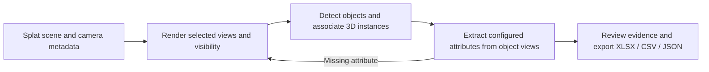

<!--
Author: rgbohner (with Codex assistance)
Date: 2026-11-20
Used for: Explains installation, customization, CLI/MCP use, development and proposed Gaussian splat research.
Why: Lets a new user operate and customize the standalone app without its original application.
-->

# CollectionFromImages

Turn a directory of collectible photographs into an Excel workbook, CSV and editable JSON. Run it as a command-line app or an optional local MCP server. No desktop app, Google account, cloud storage, or running web server is required.

The app recognizes watches, coins, comics, magazines, trading cards and other physical objects. It keeps visible evidence, uncertain fields, individual objects within a photograph, and possible duplicate-view suggestions. Optional OpenAI web research adds sourced catalog information and resale evidence.

## Install

Install **Node.js 22 or newer**, then clone this repository.

```sh
git clone https://github.com/rgbohner/CollectionFromImages.git
cd CollectionFromImages
npm ci
```

For a development checkout on macOS, Linux, WSL or Git Bash, use the setup script instead of `npm ci`:

```sh
./setup.sh
```

It checks for Node.js 22+ and npm, installs the exact `package-lock.json` dependencies, creates a private local `.env` from `.env.example` without overwriting an existing file, and runs the offline tests. It does not install Node itself, install global packages, or make paid API calls. Use `./setup.sh --skip-tests` to skip tests on a subsequent setup run.

Open `.env` and fill in your API key. The development command loads that file:

```sh
npm run dev -- build './examples' --offline -o './output/demo'
npm run dev -- build '/path/to/photos' -o './output/my-collection'
```

In Windows PowerShell, the equivalent development setup is:

```powershell
npm ci
if (-not (Test-Path .env)) { Copy-Item .env.example .env }
npm test
# Edit .env, then:
npm run dev -- build 'C:\Users\You\Pictures\Collection' -o '.\output\my-collection'
```

The dependencies include the image decoders and spreadsheet writer. macOS, Windows and Linux are supported by those dependencies; no Python, Excel installation or system image converter is required. Use a platform supported by [sharp's prebuilt binaries](https://sharp.pixelplumbing.com/install/).

## Build a collection

Set your own API key in the environment. For macOS/Linux:

```sh
export OPENAI_API_KEY='your-api-key'
npm start -- build '/path/to/photos' --output './output/my-collection'
```

In PowerShell:

```powershell
$env:OPENAI_API_KEY = 'your-api-key'
npm start -- build 'C:\Users\You\Pictures\Collection' --output '.\output\my-collection'
```

To install the command locally for convenient use, run `npm link` from this checkout. Then use:

```sh
collection-from-images build '/path/to/photos' -o './output/my-collection'
```

Quick mode defaults to `gpt-4.1-mini`. Use `--model` to select a different vision model available to your API project. Detailed mode uses the research model for recognition; its inherited default is `gpt-6.1-terra`. `--research-model` overrides that model. Model access depends on your provider account.

The build sends normalized image copies to your selected provider. OpenAI requests use `store: false`; provider billing and data policies still apply. API keys stay in the process environment and are never written into the collection. See [OpenAI image inputs](https://developers.openai.com/api/docs/guides/images-vision).

To check installation without an API key or any network calls, use the included synthetic photograph:

```sh
npm start -- build './examples' --offline -o './output/demo'
```

Offline mode uses filenames as item names and marks every item for review. It does **not** identify objects.

## Customize collection attributes

Edit [`config/collection-types.json`](config/collection-types.json) in this checkout. This is the shared source for recognition, optional catalog research, aliases, value types and spreadsheet column order. The CLI and MCP server read it at the start of each build or export; a new MCP call sees edits without restarting the server. A running build keeps its original snapshot.

The `comic` entry includes **Series, Publisher, Publication date, Author, Issue number**, plus Publication year, Variant / edition, Artist and Certification number. `Writer` is an alias for `Author`, and `Date`/`Cover date` are aliases for `Publication date`.

Each entry under `types` has a display `label` and an ordered `attributes` array. For example, you can replace `types.comic` with this smaller definition:

```json
{
  "label": "Comic books",
  "attributes": [
    { "label": "Series", "type": "text", "required": true },
    { "label": "Publisher", "type": "text" },
    {
      "label": "Publication date",
      "type": "text",
      "aliases": ["Date", "Cover date"],
      "description": "Keep the printed month/year; never invent a day."
    },
    { "label": "Author", "type": "text", "aliases": ["Writer"] },
    {
      "label": "Issue number",
      "type": "text",
      "aliases": ["Issue"],
      "required": true
    }
  ]
}
```

Keep the surrounding `version: 1` and `types` object. Add another attribute object to request a new field, reorder the array to move columns, or add a new type such as `stamps`. Keep the `items` type for miscellaneous and unidentified objects. Type IDs use lowercase letters, digits, underscores or hyphens and must start with a letter.

| Attribute property | Meaning                                                                                                                     |
| ------------------ | --------------------------------------------------------------------------------------------------------------------------- |
| `label`            | Canonical spreadsheet label and name requested from the model                                                               |
| `type`             | `text`, `number`, `date`, `boolean` or `url`; required on each attribute                                                    |
| `aliases`          | Optional alternative labels that map to the canonical label                                                                 |
| `description`      | Optional short instructions explaining what evidence to extract                                                             |
| `required`         | Optional boolean; missing visible evidence marks identification for review, and missing sourced research remains unresolved |

Use **`text` for issue numbers, serial numbers and partial dates** so `007` and `June 1984` retain their meaning. `number` and `boolean` produce typed Excel cells. `date` requires a complete `YYYY-MM-DD` date and is exported as ISO text. `url` accepts HTTP(S) links. Attribute descriptions guide extraction, but cannot supply evidence: unreadable or unsupported facts stay blank, and ownership, purchase costs, grades and authenticity are not inferred.

The configuration supports up to 30 types and 40 attributes per type. Labels and aliases must be unique within a type (ignoring case, spaces, underscores and hyphens). JSON does not support comments or trailing commas. Invalid settings stop the build before any AI request. Check syntax and validation without API calls:

```sh
node -e 'require("./lib/collection-types.cjs").loadCollectionTypes(); console.log("Configuration is valid")'
```

For each type present in the inventory, all configured attributes become `Observed: ...` columns, including blank ones. Mixed collections use type order from the JSON and then attribute order; matching labels share a column. `Researched: ...` columns appear when catalog research is enabled or saved research exists. Additional saved fields are retained after configured columns in alphabetical order. Removing a configured attribute does not delete already captured evidence.

After changing attributes, start a build in a new output directory to extract them from images. To change only an existing spreadsheet's columns and aliases without new AI requests, run:

```sh
npm start -- export './output/my-collection/collection.json'
```

Export uses the current configuration and leaves the saved JSON unchanged. New columns remain blank until you add evidence or run a new build. Existing values that cannot convert to a changed type remain as text with a warning. If renaming a label, keep its old name in `aliases` so saved fields map to the new column.

Resume requires the same configuration snapshot used by the original build; restore it or use a new output directory after an edit. Collections created before this configuration feature can still be exported, but require a new build to perform more recognition. The config belongs beside the app's `lib` directory, regardless of your current working directory. It is included in `npm pack` installations too.

## Outputs and review

Each output directory contains:

| File              | Contents                                                                                                                       |
| ----------------- | ------------------------------------------------------------------------------------------------------------------------------ |
| `collection.xlsx` | Collection table with embedded object thumbnails, photo processing log, run information, and optional research/comparable tabs |
| `collection.csv`  | Collection table for Excel, Google Sheets or other spreadsheet apps; no embedded images                                        |
| `collection.json` | Full editable inventory, source evidence, research, usage and resumable progress                                               |
| `.images/`        | Normalized JPEG previews used by exports and research                                                                          |

Review the identification, visible evidence, unresolved fields and possible duplicate IDs. “Ready for review” is model confidence, not human approval. Catalog fields preserve leading zeros and partial dates such as `June 1984`. Observed fields and researched fields have separate columns. Photos with no identified object remain as unidentified rows; failed files are listed in the Photos tab. Multiple physical objects in one photograph become separate rows. Matching titles alone never combine copies.

Edit `collection.json` to correct `items[].name`, the `label`/`value` pairs in `fields`, or set `excluded: true` for unwanted rows. Regenerate the spreadsheets without further AI calls:

```sh
npm start -- export './output/my-collection/collection.json'
```

Use `--output` to export elsewhere, or `--no-images` if you only have the JSON. XLSX/CSV exports are regenerated files: editing them does not update JSON, and another export replaces them. Keep the JSON and `.images` directory together to preserve previews. To combine views manually, move the relevant `photos` entries to the retained item and exclude the duplicate row; the XLSX displays its first photo, while the Photos column lists all views. Finish processing before making manual identity edits; a completed research report is not automatically invalidated by those edits.

Share the XLSX alone for a portable spreadsheet with thumbnails. CSV/JSON retain relative source filenames; the JSON and workbook's About tab also retain the original input directory path. Originals are never modified or copied into the repository.

## Resume, formats and options

```sh
# Include subdirectories, and start with a small batch.
npm start -- build '/path/to/photos' -o './output/trial' --recursive --limit 10

# Resume an interrupted run using the same input and output directories.
npm start -- build '/path/to/photos' -o './output/trial' --resume

# Detailed recognition plus sourced catalog and resale research.
npm start -- build '/path/to/photos' -o './output/researched' \
  --mode detailed --research all --search-budget 4

# Sourced catalog research without resale estimates.
npm start -- build '/path/to/photos' -o './output/catalog' --research catalog

# Gemini recognition (web research is currently OpenAI-only).
npm start -- build '/path/to/photos' -o './output/gemini' --provider gemini

npm start -- --help
```

For Gemini set `GEMINI_API_KEY`. `COLLECTION_AI_PROVIDER` can select a default provider. `OPENAI_MODEL`, `OPENAI_RESEARCH_MODEL`, `GEMINI_MODEL` and `GEMINI_RESEARCH_MODEL` provide defaults; CLI flags override them. If only a Gemini key exists it is selected automatically, otherwise OpenAI is the default. `npm run dev` loads `.env`; `npm start`, the linked CLI, and MCP use their process environment. Node's `--env-file` can also be used with the executable.

Supported extensions: JPEG, PNG, WebP, GIF, TIFF, HEIC, HEIF and AVIF. Animated/multipage files use the first frame/image. Images are auto-oriented, stripped of metadata and reduced to a maximum 2560-pixel edge. Files above 50 MiB or 80 megapixels are rejected with an entry in the photo log. HEIC/HEIF uses the included converter. Hidden paths and symlinks are skipped. Subdirectories are opt-in. A run is limited to 10,000 discovered images; split larger collections into directories.

Progress saves after every image and research result. Ctrl+C stops the active request and saves partial exports. Rerun with `--resume` to retry failed or unfinished work while retaining successes. Source content hashes and the file list are checked before resuming; use a fresh output directory if inputs or analysis options change. Resume inherits the original options, including recursion and limits. Successful results are not automatically refreshed.

If a process is force-killed, its `.collection.lock` file may remain. Verify no process is using that output directory before removing the lock and resuming.

A process killed before receiving/saving an API response can leave an unknown charge. Resuming may repeat that unfinished request. Usage estimates are marked partial after interrupted/failed requests. Rate-limit and authentication failures stop subsequent requests. There are no automatic paid retries. Missing thumbnails are reported in the result and the workbook; the JSON remains usable.

Research is off by default. `--research catalog`, `resale`, or `all` enables additional paid requests. `--search-budget` allocates 3–20 web calls per item, plus structured extraction requests; it is not a monetary cap. The inherited price table is dated in the output and may become stale. Resale estimates require supporting evidence: asking prices remain distinct from completed sales, currencies are not combined, and insufficient evidence produces an empty estimate. AI proposals are not authenticity certifications or professional appraisals.

The command writes a JSON summary to stdout and progress to stderr. Exit codes are `0` for complete, `1` for invalid input/fatal error, `2` for partial/interrupted provider work, and `130` for a user interrupt. “Complete” means processing finished; review can still be required.

## Optional MCP server

The same app provides two stdio MCP tools, `build_collection_spreadsheet` and `export_collection_spreadsheet`. Starting `mcp` explicitly enables them; no other app's settings are consulted and no network listener opens. The transport follows the [MCP stdio specification](https://modelcontextprotocol.io/specification/2025-11-25/basic/transports).

Use your MCP client's server configuration, with absolute paths:

```json
{
  "mcpServers": {
    "collection-from-images": {
      "command": "node",
      "args": [
        "/absolute/path/CollectionFromImages/bin/collection-from-images.cjs",
        "mcp"
      ],
      "env": { "OPENAI_API_KEY": "your-api-key" }
    }
  }
}
```

Use your client's secret/environment facilities for the key; do not commit its real value. On Windows use escaped absolute Windows paths. If the client cannot find Node, set `command` to Node's full path.

Example build-tool arguments:

```json
{
  "directory": "/absolute/path/to/photos",
  "output": "/absolute/path/to/output/my-collection",
  "recursive": true,
  "research": "none"
}
```

Build arguments also accept `resume`, `offline`, `provider`, `model`, `researchModel`, `mode`, `effort`, `searchBudget`, and `limit`. Export arguments are `file` (absolute JSON path), optional `output`, and `images`. Tool results return local output paths, counts and usage. MCP cancellation stops active builds and preserves progress. Set a generous client tool timeout for larger directories or detailed research.

## Development and extraction boundary

```sh
npm test
npm pack --dry-run
```

`setup.sh` can be run from any working directory. Re-running it refreshes local dependencies and preserves your `.env`. For MCP to load that same file, add `--env-file=/absolute/path/CollectionFromImages/.env` to the Node argument list before the executable path, or use the client's environment settings.

The offline suite exercises the real CLI, stdio MCP subprocess, HEIC conversion, workbook/image readback, mocked provider requests, citations, valuation rules, cancellation, corrupt input, source changes, configurable attributes, custom collection types and resume behavior. It does not call paid APIs or establish recognition accuracy. GitHub Actions runs the suite on macOS, Windows and Linux with Node 22 and 24.

`lib/photo-recognition.cjs` and its provider/research helpers handle recognition and research. `config/collection-types.json` defines the editable collection attributes, `lib/collection-types.cjs` loads and validates them, and `lib/catalog.cjs` normalizes observed values. Directory scanning, progress files, CLI, exports and the photo-specific MCP interface are standalone. See [NOTICE.md](NOTICE.md) for provenance.

Keep personal photographs outside the checkout. `.env`, common credential files and generated collection outputs are ignored by Git. Before sharing a generated workbook or JSON, review its photographs, source filenames, original directory path and research content; exports contain your collection data.

See [FILE_GUIDE.md](FILE_GUIDE.md) for every project file's author, documentation date, purpose and rationale. Source and supporting text files also carry local headers; JSON, generated and binary files use the guide to preserve their formats. Dates describe the header documentation date, not the original creation date of adapted code.

## Follow-up work: identify collections from Gaussian splats

**Proposal only; literature reviewed on 2026-11-20.** The current app accepts photographs, not Gaussian splat files. Here, “identification” means finding each physical collectible represented in a 3D scene and extracting attributes such as comic series, publisher, publication date, author and issue number. Recognizing a category, locating a particular physical copy, and reading its exact catalog identifiers are separate tasks.

A 3D Gaussian splat scene describes appearance and geometry through many overlapping primitives; it does not inherently contain an inventory or reliable object IDs. The original [3D Gaussian Splatting paper and project (SIGGRAPH 2023)](https://repo-sam.inria.fr/fungraph/3d-gaussian-splatting/) established the rendering representation. Adding `.ply` to this app's accepted image extensions would not provide identification support.

### Current state of the art and its relevance

Research now supports language-guided localization, segmentation of individual objects, and increasingly general scene reasoning. The table separates established work from recent preprints. These are representative approaches relevant to this app, not a universal leaderboard: rendered-mask accuracy, 3D instance accuracy, language grounding, text readability and rendering speed measure different capabilities. Reported research gains have not been reproduced in this repository.

| Research and status                                                                                                                                                                                         | Demonstrated direction                                                                                                                                                    | Implication for collection identification                                                                                                                                                                                                            |
| ----------------------------------------------------------------------------------------------------------------------------------------------------------------------------------------------------------- | ------------------------------------------------------------------------------------------------------------------------------------------------------------------------- | ---------------------------------------------------------------------------------------------------------------------------------------------------------------------------------------------------------------------------------------------------- |
| [LangSplat](https://langsplat.github.io/) — CVPR 2024; [LangSplatV2](https://arxiv.org/abs/2507.07136) — NeurIPS 2025                                                                                       | Embed language features in Gaussian scenes for open-vocabulary queries. V2 uses sparse coefficients and a shared dictionary to accelerate feature rendering and querying. | Useful for locating objects described in words. Its rendering/query speed does not include this app's image analysis, OCR or catalog research, and does not establish exact edition identification.                                                  |
| [Gaussian Grouping](https://arxiv.org/abs/2312.00732) — ECCV 2024; [OpenGaussian](https://proceedings.neurips.cc/paper_files/paper/2024/hash/21f7b745f73ce0d1f9bcea7f40b1388e-Abstract.html) — NeurIPS 2024 | Learn object identity or instance features using 2D masks and 3D consistency. OpenGaussian connects language features to groups of Gaussian points.                       | Relevant baselines for assigning multiple rendered views to one object and selecting its Gaussian subset. Semantic similarity alone should not merge two physical copies.                                                                            |
| [GenSplat](https://fawnliu.github.io/project/gensplat/index.html) — CVPR 2026                                                                                                                               | Combines progressively trained language grounding, multimodal reasoning and geometry-aware frame selection for cross-scene segmentation and question answering.           | A stronger reference for free-form queries and choosing informative views. Its [official repository](https://github.com/fawnliu/GenSplat) still advertises a forthcoming code release at this review date; do not assume a ready-to-install backend. |
| [GaussDet: Open-Vocabulary and Referring Segmentation for 3D Gaussians Using 2D Detectors](https://arxiv.org/abs/2606.30638) — June 29, 2026 preprint                                                       | Groups Gaussians into instances and aggregates semantic votes from 2D detections across rendered views.                                                                   | Closely matches a practical hybrid extension: use a 3D scene for identity and existing 2D models for recognition. It addresses grounding, not complete collector attribute records.                                                                  |
| [InstanceSplat](https://arxiv.org/abs/2608.07144) — August 7, 2026 preprint                                                                                                                                 | Produces appearance, geometry, instance identity and language-aligned semantics jointly from pose-free multi-view images in a feed-forward framework.                     | Promising when the app controls capture/reconstruction. This is not evidence that its model can ingest any existing third-party splat file unchanged.                                                                                                |
| [Imagine3D-LLM](https://arxiv.org/abs/2609.38177) — September 29, 2026 preprint, author-listed NeurIPS 2026                                                                                                 | Trains a multimodal language model with compact Gaussian scene representations and reconstruction supervision to improve spatial reasoning.                               | A research direction for stronger reasoning across views; its inputs are multi-view images, so it is not a drop-in raw-splat reader for the current API integration.                                                                                 |
| [RefineSplat](https://arxiv.org/abs/2611.10379) — November 7, 2026 preprint                                                                                                                                 | Tracks objects before reconstructing them as separate Gaussian sets, then uses reconstruction feedback and viewpoint-dependent language embeddings to refine consistency. | Relevant to stable object boundaries and evidence association. Its reconstruction/tracking workflow is a different input regime from receiving only a finished `.ply` file.                                                                          |
| [STRinGS](https://strings-official.github.io/) — WACV 2026                                                                                                                                                  | Selectively refines text regions during reconstruction and evaluates readability with OCR character error rate, including text-heavy book scenes.                         | Especially relevant to comic issue numbers and credits: visually plausible rendering can still lose identifying characters. Fine text needs its own evaluation, beyond overall image quality or segmentation.                                        |

For this project, the important remaining question is **whether an object can be converted into an accurate, evidence-backed catalog row**. The cited methods establish useful components; their reported scene-understanding results do not by themselves establish reliable comic issue, publisher, author or physical-copy identification. That is an application-level inference from their task definitions, and needs a dedicated evaluation.

### Recommended extension design

Start with **rendered views plus explicit 3D instance association**, retaining the current collection schema, attribute configuration and exporters. Make a learned semantic-Gaussian backend optional once a measured baseline exists.



The following components and command are proposed, not implemented:

1. **Scene input and validation.** Add a `build-splats` command and a scene adapter, initially for one documented 3DGS PLY layout. Validate centers, scales, rotations, opacity and appearance coefficients; ordinary point-cloud PLY is insufficient. A sidecar manifest should state coordinate conventions, camera intrinsics/poses, scene bounds, known scale, capture provenance and optional source-image paths. Require camera metadata or explicitly supplied viewpoints; don't silently guess a safe room-scale camera orbit. Add `.splat`/`.spz` adapters only after testing their conventions.
2. **A separate rendering worker.** Keep the Node CLI and image-only installation usable. An optional Python/PyTorch worker using [gsplat (JMLR 2025, Apache-2.0)](https://www.jmlr.org/papers/v26/24-1476.html) is a suitable research candidate; it brings its own GPU/toolchain requirements. Its [rasterization API](https://docs.gsplat.studio/main/apis/rasterization.html) exposes batched camera rendering, depth and feature channels. [Spark's browser renderer](https://sparkjs.dev/docs/overview/) is another candidate for viewing and selecting camera positions, but automated headless rendering would need separate validation. Keep backend licenses and model-weight terms separate from this project's MIT license.
3. **Object proposals and consistent identity.** Detect/segment objects in selected views and associate masks with visible Gaussian contributions, then reconcile overlaps across cameras. Depth and Gaussian centers alone are insufficient at blended boundaries or behind foreground objects; use visibility and occlusion checks. Store one instance ID per physical object in the frozen scene, with its Gaussian subset or equivalent spatial membership. Two identical comic covers can represent two different copies. For uncertain associations, preserve separate proposals for review.
4. **Attribute extraction across views.** Add an object-view recognizer that explicitly accepts different camera views of the same 3D instance. Reuse `config/collection-types.json` for its requested fields, aliases and required-attribute checks. Do not pass independent viewpoints into the current `identifyPhoto` detail-image path: that prompt explicitly treats additional images as crops of one photograph. Prefer original high-resolution capture crops for small printed identifiers when available; retain conflicts and unreadable fields instead of choosing a plausible value.
5. **Evidence, caching and export.** Extend saved state with scene hash, instance ID, Gaussian membership reference, camera ID/matrices, rendered/source crop, per-field evidence and whether a value came from an original photograph, reconstruction or web research. Use scene, configuration, renderer and model versions in cache/resume keys. Preserve the existing attribute columns and add scene/instance references and a representative thumbnail. Version the state format and migrate/validate it before supporting resume. A reoptimized scene may reorder Gaussians, so old primitive indices cannot be reused blindly.
6. **Coverage and uncertainty.** Choose additional supported views for unresolved required attributes and stop at a view/API budget. Multiple renders from one reconstruction are correlated evidence, not independent confirmations. Request a real capture or manual review when the available scene cannot resolve a label. Unknown scene scale must not produce invented millimeter measurements, and generated or completed geometry must not be treated as proof that a collectible exists in a real inventory.

Manually rendering PNG/JPEG views and running the existing `build` command is already possible as an external preprocessing experiment. It produces per-view observations; **the current app does not perform 3D association or automatically collapse those views into one inventory row**.

### Potential research opportunities

These are hypotheses for investigation, not claims of novelty or achieved improvements. Any publication claim would require a fuller related-work review and controlled comparisons.

| Opportunity                                            | Closest prior work and proposed distinction                                                                                                                                                                                                                                                             | Experiment and success measure                                                                                                                                                                                                                                 |
| ------------------------------------------------------ | ------------------------------------------------------------------------------------------------------------------------------------------------------------------------------------------------------------------------------------------------------------------------------------------------------- | -------------------------------------------------------------------------------------------------------------------------------------------------------------------------------------------------------------------------------------------------------------- |
| **Attribute-driven view selection**                    | GenSplat already selects informative frames; [object-centric next-best-view work (ICRA 2026)](https://arxiv.org/abs/2602.08266) already targets object reconstruction. Test whether choosing views specifically to resolve missing configured fields beats geometry-only or generic semantic selection. | Compare uniform, geometry-aware and field-aware policies at the same render/API budget. Measure exact field accuracy, verified required fields per request, latency and cost. Distinguish selecting existing renders from acquiring genuinely new photographs. |
| **Reliable identity for near-identical copies**        | Gaussian Grouping, OpenGaussian, GaussDet and RefineSplat address instance structure. Test additional physical-copy constraints using spatial separation, tiny persistent markings and cross-view consistency in collector scenes.                                                                      | Include repeated editions, stacks and partially occluded copies. Measure instance AP, object-count error, false merges, duplicate rows and identity consistency across views. A gain in semantic segmentation alone is insufficient.                           |
| **Text fidelity optimized for catalog identifiers**    | STRinGS already improves text reconstruction. Investigate whether reconstruction/view selection guided by exact attribute tokens preserves issue suffixes, serial numbers and credits better at fixed scene size and training cost.                                                                     | Compare original capture crops, vanilla splat renders and text-aware reconstruction. Report character error rate, exact identifier match, attribute accuracy and unsupported-value rate; include unreadable labels that require abstention.                    |
| **Calibrated evidence across correlated views**        | Multi-view semantic aggregation exists in GaussDet; the open question here is confidence in exact inventory facts. Test evidence fusion that tracks shared reconstruction provenance and contradictory readings rather than treating render votes as independent.                                       | Compare majority voting, confidence-weighted fusion and provenance-aware fusion. Measure calibration, error at matched answer coverage, false assertions and human correction time. Use independently captured photos as a separate evidence condition.        |
| **Generalization and compression for inventory tasks** | GenSplat and InstanceSplat target generalization; extend evaluation to unseen collectors, capture tools, splat encodings and compressed scenes. Test preserving small attribute-bearing regions rather than only average visual quality.                                                                | Hold out entire objects and scenes. Measure field accuracy and instance counts versus file size, memory and runtime, with separate splat-only and source-images-available results.                                                                             |

### Evaluation and a bounded first milestone

Use established scene datasets/protocols from the cited methods for comparability, then add a consented or synthetic collector benchmark with exact physical-instance and attribute annotations. Include single-object turntables, cluttered shelves, repeated issues, reflective sleeves, thin stacked items and deliberately unreadable labels. Keep every view and reconstruction of the same physical scene in one data split, and hold out editions/objects where practical to prevent memorization from inflating accuracy.

Evaluate the final inventory: detection recall, instance AP, false merges, duplicate rows, per-field exact match, identifier character error rate, unsupported assertions, abstention coverage, API cost and GPU memory. Also report reconstruction and segmentation metrics, but do not use rendering FPS or image similarity as a substitute for attribute correctness. Compare a single-photo baseline, all original photos, fixed rendered views, adaptive rendered views and a semantic-Gaussian method under matched budgets. Report reconstruction/preprocessing costs separately from query costs.

A suitable **first development stage, not started**, is a four-active-hour feasibility experiment: 0.75h to validate a known scene and camera manifest, 1.25h to produce deterministic views using an already working renderer, 1h to connect those views to a mocked/offline inventory export, and 1h for readback checks and a measured report. Inputs are a licensed static single-object splat, supplied camera poses and expected labels; no reconstruction training or automatic multi-object grouping is included. Its independent acceptance checks are valid reproducible renders, preserved camera/evidence references, a readable workbook with the configured columns, rejection of invalid scene data, and an explicit record of hardware limitations and which accuracy claims remain unmeasured. A real-model accuracy trial would be separately budgeted. Stop and split the stage if it reaches five active hours; use the findings to estimate subsequent work instead of treating the whole research pipeline as a small importer change.

## License

This project uses the [MIT license](LICENSE). You may use, modify and redistribute it, including commercially, while retaining its copyright and permission notice. It is provided without warranty. See the [Open Source Initiative MIT license](https://opensource.org/license/mit) for the standard terms. Dependencies retain their own licenses; see [NOTICE.md](NOTICE.md).
